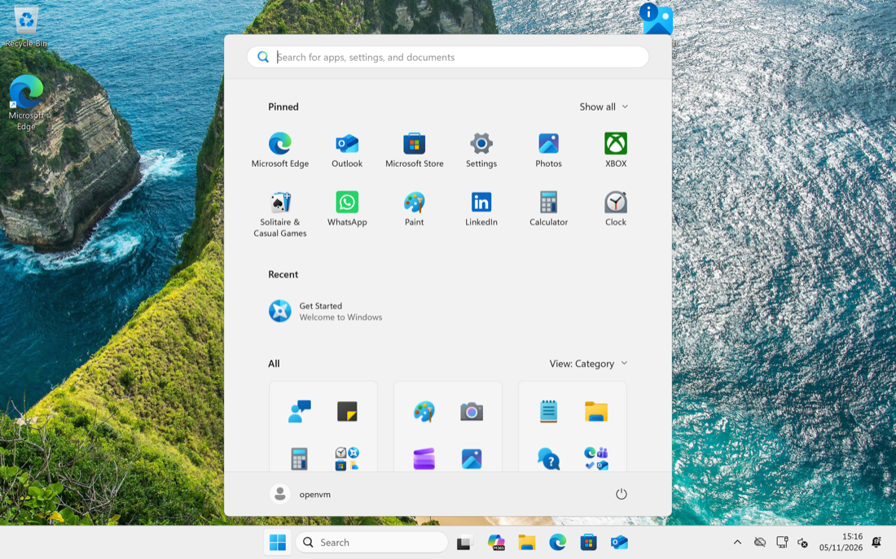

# openVM

**Run Windows and Linux on your Mac, connected to macOS like they belong there.**

openVM is a free, open-source virtual machine manager for Apple Silicon. Your guest shares your clipboard, files, printers, sound, screen size and clock with your Mac, so it feels like part of your computer and not a machine in a box.

Built in Swift and C, on Apple's own `Virtualization.framework`.



> **Early release.** openVM now has a window for each VM, a library, a setup wizard and a menu-bar icon, and everything still works from `openvmctl` too. Several parts have been tested by script but not yet by hand in the app; the list is in [docs/manual-checks.md](docs/manual-checks.md).

## Why openVM

* **Built on Apple's hypervisor.** ARM guests run directly on your Mac's CPU, with no translation layer.
* **Deep integration.** The connection between macOS and the guest is the product, not an add-on.
* **Your own installers.** Windows installs unattended from your own ISO, and any ARM64 Linux installs from its own ISO with its own installer.
* **Free and open.** Apache 2.0 licensed, with no account and no subscription.

## Features

| Feature | Windows | Linux, from an ISO |
| --- | --- | --- |
| A window for each VM, with keyboard and mouse | Yes, at 1024 pixels wide for now | Yes |
| Resizing with the window | Not yet (held at 1024 wide) | Yes, if the distribution's display driver supports it |
| Clipboard | Yes, following focus (text; passwords are never shared) | Opt-in, through `spice-vdagent` on X11 desktops (passwords are shared too) |
| File transfer and shared folders | Yes | Not yet |
| Drag files into a guest | Yes | Not yet |
| Send files from a guest to your Mac | Yes | Not yet |
| A guest that restarts itself comes back | Yes | No: the VM stops, press Start |
| Print to your Mac's printers | Yes | Not yet |
| Sound through your Mac | Opt-in, see below | Depends on the distribution |
| Clock and time zone follow your Mac | Yes | The guest keeps its own |
| Safe pause when your Mac sleeps | Yes | Yes |

Windows guests run openVM's guest tools, which carry clipboard, files, printing and the rest. Linux guests are installed from the distribution's own ISO and have no openVM tools yet.

## Requirements

* An Apple Silicon Mac, on macOS 14 or later
* Swift 6, from Xcode or the Command Line Tools
* For Windows guests: your own Windows 11 ARM64 ISO. Nothing else to install: openVM builds the install media itself, using `wimlib` from Homebrew if the Mac has it, and otherwise a short-lived helper VM that fetches its own copy (it needs a small download first, below). `zig` and `lld` are only needed to build openVM's payload from source
* For Linux guests: the ARM64 (aarch64) ISO of the distribution you want

## Get started

Build openVM, the payload (the files Windows install media is built from), and the daemon's signature, which gives it the Virtualization entitlement:

```sh
make check
make payload
codesign --force --sign - --entitlements tools/build/vm.entitlements.xml --options runtime .build/debug/openvmd
```

Start the daemon, and leave it running. It finds the payload in `.build/payload` when started from this directory, or wherever `OPENVM_PAYLOAD` points:

```sh
.build/debug/openvmd
```

Or build the app, which carries its own payload, hosts the VMs itself, and shows each one in a window (use one or the other, not both):

```sh
make app
open .build/openvm.app
```

The app's wizard creates Windows and Linux guests for you: it checks your ISO, converts a Windows one into install media, and installs. The commands below do the same by hand.

### Create a Windows guest

Check that the ISO is one openVM can use, then build the install media (about a minute, once per ISO). It goes in `$OPENVM_HOME/media`:

```sh
.build/debug/openvmctl windows-iso check ~/Downloads/Win11_Arm64.iso
.build/debug/openvmctl task start windows-media --iso ~/Downloads/Win11_Arm64.iso --name win   # prints a task id
.build/debug/openvmctl task status <task-id>                                                    # until state=done
.build/debug/openvmctl create win --boot-mode windows --install-media ~/.openvm/media/win.raw --diskSizeMB 65536
.build/debug/openvmctl start win     # first start installs Windows
```

Without `wimlib` on the Mac, fetch the helper VM's files first (`openvmctl task start fetch-linux`, about 40 MB): the media is then built in a short-lived helper VM, which installs its own copy of wimlib. The media needs about 22 GB of disk while it exists.

From the wizard you choose the Windows user name and password. Built by hand, the guest has an administrator account `openvm` with the password `openvm`, so change it if the guest matters to you.

### Create a Linux guest

Use **New Virtual Machine ▸ Linux, from an ISO** in the app, or:

```sh
.build/debug/openvmctl linux-iso check ~/Downloads/distro-arm64.iso
.build/debug/openvmctl create mylinux --boot-mode linux-iso --install-media ~/Downloads/distro-arm64.iso --diskSizeMB 65536
.build/debug/openvmctl start mylinux       # finish the distribution's own installer in the VM's window
.build/debug/openvmctl eject mylinux       # with the VM stopped, once it is installed
```

The ISO must be an ARM64 (aarch64) build that boots by UEFI: Macs with Apple silicon cannot run Intel and AMD builds. Ubuntu, Debian, Fedora and Kali publish these. Official Arch Linux is x86-64 only, and Omarchy is built on it, so only a community ARM64 build of Omarchy can work.

These guests run without openVM's guest tools, so drag and drop, Send to Mac, shared folders, printing and clock sync do not work in them yet. The clipboard can be shared if you turn it on in the VM's settings and install `spice-vdagent` in the guest. It works on X11 desktops, not on most Wayland ones such as Omarchy, and it shares everything you copy, passwords too. When a guest restarts itself the VM stops; press Start.

**If the guest makes no sound.** Most current desktops play through PipeWire, which drives the VM's sound device in chunks too small for it, so nothing is heard. Put this in `~/.config/wireplumber/wireplumber.conf.d/51-openvm-sound.conf` in the guest (the file is also in this repository, `tools/guest/pipewire/`):

```
monitor.alsa.rules = [
  {
    matches = [ { node.name = "~alsa_output.*" } ]
    actions = {
      update-props = {
        api.alsa.period-size = 1024
        api.alsa.period-num = 4
        api.alsa.headroom = 1024
      }
    }
  }
]
```

then run `systemctl --user restart wireplumber pipewire pipewire-pulse`. This is for WirePlumber 0.5 and later (`wireplumber --version`). Sound from the VM reaches the Mac about a tenth of a second late, so it suits music and video better than games and calls.

**If scrolling runs the wrong way.** The VM's pointer scrolls the way your fingers move, whatever your Mac is set to. To match a Mac with natural scrolling, turn on natural scrolling for the mouse in the guest. In Omarchy, add `natural_scroll = true` directly inside `input` in `~/.config/hypr/input.lua` (not inside `touchpad`: the VM's pointer is not a touchpad). In GNOME it is Settings ▸ Mouse & Touchpad ▸ Mouse ▸ Natural Scrolling.

**If the desktop does not fill the window.** The VM's display takes the window's size, and full screen's, and the guest's kernel sees each new size, but a desktop has to switch to it. Hyprland, and so Omarchy, does not, which leaves black bars. Copy `tools/guest/hyprland/openvm-fit-display.sh` into the guest as `~/.local/bin/openvm-fit-display`, make it executable, and have Omarchy start it at login:

```sh
printf '\nhl.on("hyprland.start", function()\n  hl.exec_cmd("%s/.local/bin/openvm-fit-display")\nend)\n' "$HOME" >> ~/.config/hypr/autostart.lua
```

It also sets the guest to 2x scale, like a Retina Mac; set `OPENVM_SCALE=1` for a display that is not Retina. Other desktops have not been checked.

## Using a guest

```sh
openvmctl list                                       # your VMs
# the rest need openVM's guest tools, so a Windows guest for now:
openvmctl clipboard push win                         # send your clipboard to the guest
openvmctl file push win report.pdf                   # copy a file in
openvmctl share add win ~/Projects                   # share a folder
openvmctl drag drop win ~/Downloads/photo.jpg        # put a file on the guest's Desktop
openvmctl display set win --width 2560 --height 1664 --scale 2
openvmctl suspend win
openvmctl stop win
```

Run `openvmctl` with no arguments to see every command.

## Before you rely on it

* **Alpine guests from earlier versions no longer start.** openVM used to make its own Alpine Linux guest. It now installs Linux from the distribution's ISO instead. An Alpine VM made before stays in the list and can be deleted, which deletes its disk; copy the disk file first if you want it.
* **A Windows guest needs a fixed display driver.** The app gives a Windows guest the window's full size, Retina included. With the display driver in today's virtio-win release (`viogpudo` 0.1.302), every size but the one Windows started at draws scrambled. The fault is reported upstream with two fixes under review; until a signed release carries one, a guest needs a driver built with a fix. See [docs/gui-notes.md](docs/gui-notes.md).
* **Guests always use natural scrolling.** The VM's pointer scrolls the way your fingers move, ignoring your Mac's scroll direction setting, and the app cannot change that. So openVM's tools set natural scrolling in a Windows guest, matching the Mac's default, each time the guest starts. If your Mac has natural scrolling off, set `FlipFlopWheel` to 0 for the mouse in Windows yourself, and know the tools set it back at the next start. A Linux guest has no openVM tools; see "Create a Linux guest".
* **Windows guests installed before November 2026 show an extra, invisible display.** A window dragged off the right edge can get lost there. Newer guests' tools switch it off. In an older guest, Settings ▸ System ▸ Display ▸ "Show only on" the VirtIO display hides it, and that survives a restart.
* **Building Windows media may need a newer macOS than the app does.** The media script uses `diskutil image`, which older releases of macOS do not have. It has only been run on macOS 27.
* **Windows sound needs Test Mode.** Windows guests are silent by default, because no Microsoft-signed driver exists for Apple's virtual sound device. `openvmctl audio enable <vm> --test-mode` installs a third-party test-signed driver, then you restart the VM. Test Mode weakens driver signature checks, trusts a third party's certificate in the guest, and shows a desktop watermark. `openvmctl audio disable <vm>` and a restart undo it.
* **Windows guests use a private Apple API.** They need `_setPerformanceMonitoringUnitEmulationEnabled:`, which Apple could remove in any macOS release. It also keeps openVM off the Mac App Store. Linux guests do not use it.
* **Large copies inside Windows can fail.** A bug in the current virtio-win release can fail big reads from a shared folder. openVM's own drops retry around it, but a copy you start inside Windows can still stop with an error.
* **Printing has only been tested with a stand-in printer so far,** not on real paper.

## Roadmap

* openVM's guest tools in a Linux guest installed from its ISO (clipboard, files, printing, clock)
* Dragging files out of a guest, straight from its window (files can be sent with "Send to Mac" today)
* Microphone
* Windows sound without Test Mode

## For developers

```sh
make check                                       # build, Swift tests, guest agent tests
tools/test/daemon-smoke.sh                       # the daemon and CLI, no guest, seconds
make windows-smoke ISO=<windows-iso>             # real Windows install, about 30 minutes
```

See [docs/testing.md](docs/testing.md) for what each one covers.

```
Sources/OpenVMCore/       wire protocol, VM registry, shared rules
Sources/OpenVMWindows/    the Windows VM configuration
Sources/OpenVMHost/       the host library: VM lifecycle and host-side features
Sources/OpenVMApp/        the app: VM windows, library, wizard, menu bar
Sources/openvmd/          a headless host, for scripts and the smokes
Sources/openvmctl/        the command-line client
Sources/openvm-mockguest/ a guest stand-in for tests
Tests/                    Swift tests
tools/build/              fetching guest parts, building agents and install media
tools/test/               C agent tests and the real-guest smokes
tools/guest/              the guest agents and the shared wire codec
tools/uefi/               the boot chain Windows guests start from
tools/windows/            install and first-boot scripts for Windows guests
docs/                     protocol, VM config and Windows guest notes
```

## Documentation

Start with [docs/README.md](docs/README.md). To contribute, see [CONTRIBUTING.md](CONTRIBUTING.md), and to report a security problem, see [SECURITY.md](SECURITY.md).

## License

Apache License 2.0. See `LICENSE`.

Windows, its drivers and the optional sound driver are not part of openVM and keep their own licenses. They are fetched or built from your own media on your machine. The optional sound driver comes from the [Droid-VM](https://github.com/Droid-VM/gunyah-guest-drivers-windows) project.
